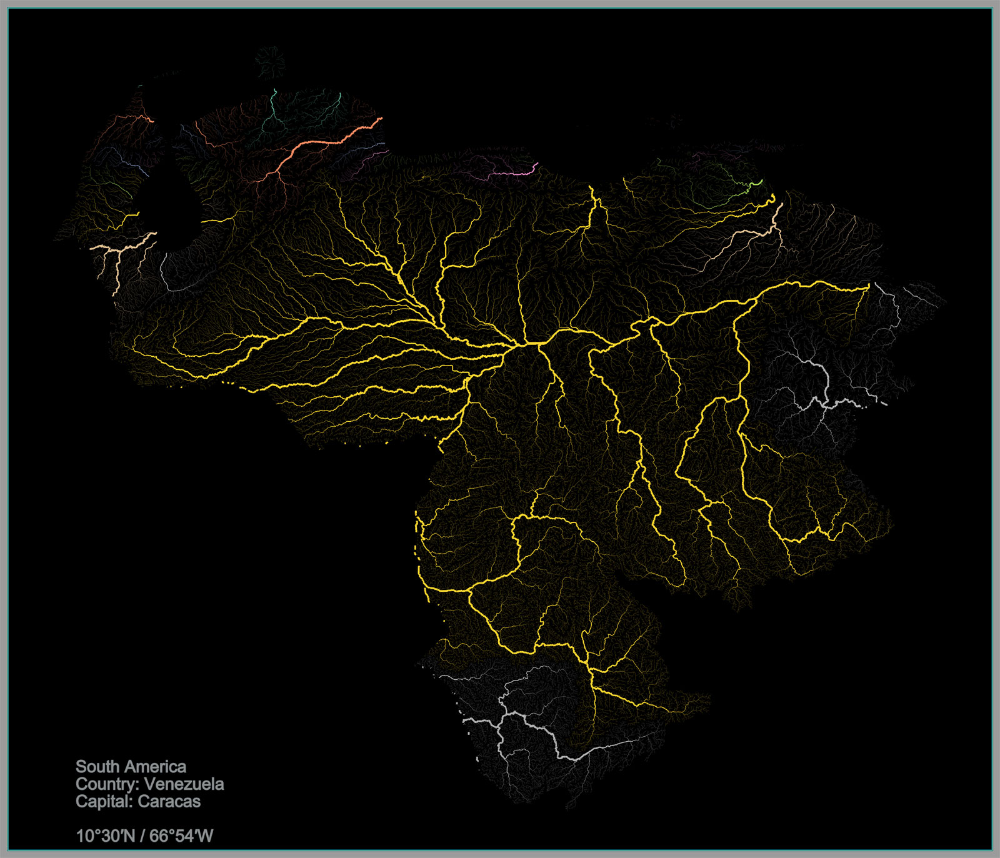

# HydroRIVERS river maps

The aim of the project is to filter and stylise the global river network of a single country or an entire continent.

The visualisation of the river network can be based either on a single parameter or on a combination of them, e.g.:

1. An indicator of river order according to the Strahler ordering system: order 1 represents upstream streams; when two 1st order streams meet, they form a 2nd order river; when two 2nd order rivers meet, they form a 3rd order river; etc. 
2. A river order indicator according to the classical ordering system: order 1 represents the main river from source to source; order 2 represents all tributaries flowing into the 1st order river; order 3 represents all tributaries flowing into the 2nd order river; etc. This ordering system can be used to identify 'mainstem' rivers, i.e. the main stem of a river from source to discharge. 
3. A river order indicator using river discharge to distinguish dimensions: order 1 represents river sections with mean perennial discharge ≥ 100,000 m3/s; order 2 represents river sections with mean perennial discharge ≥ 10,000 m3/s and < 100,000 m3/s; .... order 9 represents river sections with mean perennial flow ≥ 0.001 m3/s and < 0.01 m3/s; and order 10 represents river sections with mean perennial flow < 0.001 m3/s (i.e. 0 in the reported data due to rounding to 3 digits).
4. An indication of the total area in the upstream reach, in square kilometres, calculated from the headwaters to the spill point (i.e. the lowest pixel) of the reach. The upstream area includes only the area directly associated with the catchment, i.e. it does not include endorectal regions that may be nested within the larger basin.

River line colours are the appropriate Matplotlib or Colorcet colour palette.



## Setup

```bash
python -m venv .venv
.venv\Scripts\activate          # Windows; on Linux/macOS: source .venv/bin/activate
pip install -r requirements.txt
```

Download a region from [HydroRIVERS](https://www.hydrosheds.org/products/hydrorivers)
(shapefile or geodatabase) and convert it once to GeoParquet:

```bash
python convert_to_parquet.py HydroRIVERS_v10_sa_shp/HydroRIVERS_v10_sa.shp data/HydroRIVERS_v10_sa.parquet
```

The Parquet file is about 5x smaller than the shapefile and is read in seconds
instead of minutes. It is sorted spatially and has a bounding-box column, so a
single country is read without loading the rest of the continent.

## Making maps

```bash
# a whole continent, without the smallest streams
python hydro_map.py data/HydroRIVERS_v10_sa.parquet --label "South America" --min-upland 50 --max-ord-flow 6

# one or more countries: rivers are clipped at the border,
# the caption shows continent, capital and its coordinates
python hydro_map.py data/HydroRIVERS_v10_sa.parquet --country Venezuela Uruguay --flag

# colour by flow order instead of river system, in an equal-area projection
python hydro_map.py data/HydroRIVERS_v10_eu.parquet --country Germany --color-by ORD_FLOW --cmap viridis --crs EPSG:3035
```

Maps are written to `maps/<name>.png`. `python hydro_map.py -h` lists all options:
filters (`--min-upland`, `--max-ord-flow`, `--max-ord-stra`, `--max-ord-clas`,
`--where`), line widths, colormap, background, resolution (`--dpi 600` for print)
and caption position.

Country boundaries and capitals come from [Natural Earth](https://www.naturalearthdata.com/)
and flags from [flagcdn.com](https://flagcdn.com/); both are downloaded on first use
and cached in `data/cache/`. Country names can be given in English, German or
Russian, or as an ISO code.

## Project layout

| File | Purpose |
| --- | --- |
| `hydro_map.py` | command-line tool that makes the maps |
| `convert_to_parquet.py` | one-time conversion of a HydroRIVERS download |
| `hydromap/data.py` | reading by bounding box, clipping, filters |
| `hydromap/places.py` | countries, capitals and flags |
| `hydromap/render.py` | line widths and colours, drawing, frame and caption |

## Data

HydroRIVERS v1.0, © WWF / HydroSHEDS. Lehner, B., Grill G. (2013): Global river
hydrography and network routing: baseline data and new approaches to study the
world's large river systems. Hydrological Processes, 27(15): 2171–2186.
